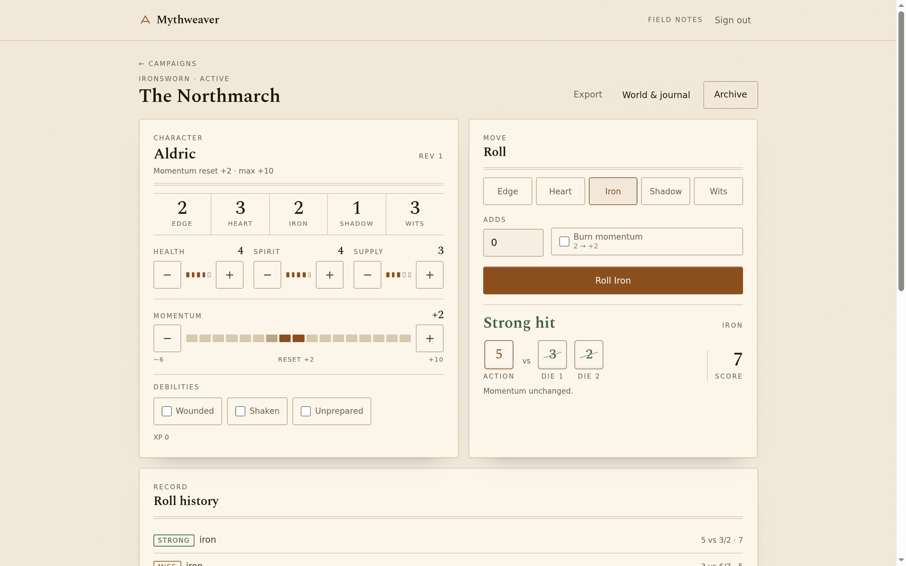
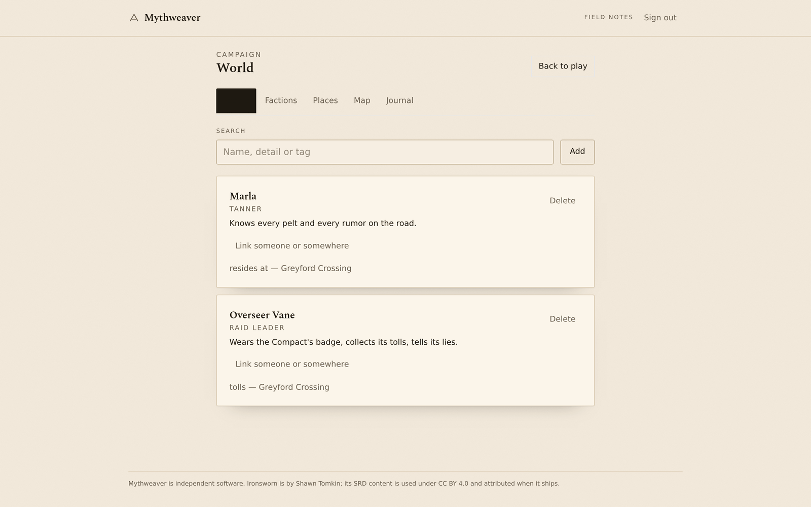
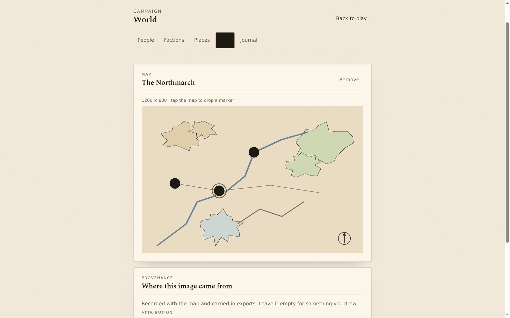
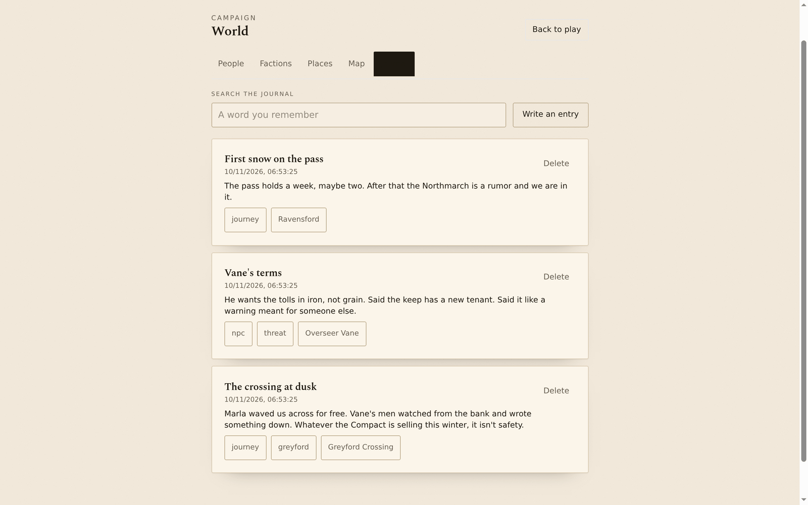
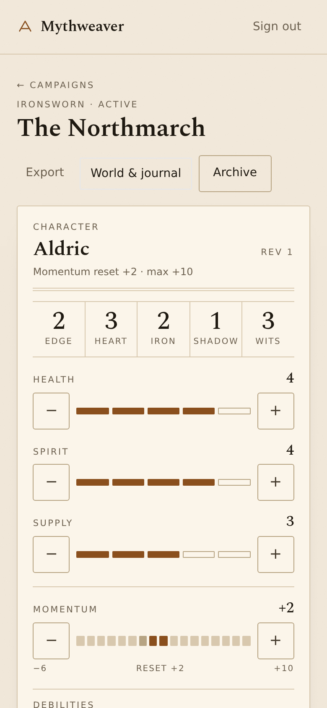

# Mythweaver

[](https://github.com/sleuthy-sloth/mythweaver/actions/workflows/ci.yml)

Self-hosted, offline-first platform for solo tabletop role-playing. First ruleset: **Ironsworn**.

Play on a plane, in a cabin, on a phone with one bar of signal — the app keeps working, queues
your rolls and edits, and settles up with the server when you're back. Your campaigns live in
your own Postgres, on your own hardware, behind your own reverse proxy. No cloud account, no
subscription, and no AI in the loop unless you ask for one.

Multi-user: a household or a friend group can each hold an account on one install, and campaign
data is isolated per member.

**Status: Phase 4c, hardening begun.** Sign in, open a campaign, play with the network gone, and
your edits and rolls queue and send themselves when you reconnect. Campaigns hold a character
sheet, people, factions, places, a searchable journal, and a map with markers — and the whole
thing leaves the server as a checksummed JSON file that imports back as a fresh copy. See
[PLAN.md](./PLAN.md) for the honest list of what exists and what doesn't yet.

## What it does

- **Ironsworn play.** Character sheet with stats, meters, momentum (derived reset and burn),
  debilities and XP. Roll action + two challenge dice with a tap; strong hit, weak hit or miss —
  matches included — with the dice rendered as physical objects and every roll kept in permanent
  history.
- **A world with a memory.** People, factions and places; relationships between them; a journal
  with explicit links and full-text search.
- **Maps.** One uploaded map image per campaign, tap to place markers, link markers to places.
  Coordinates are normalized, so markers stay put on any screen size.
- **Take the campaign with you.** One-click export to a checksummed, versioned JSON file; import
  previews it, validates every reference, and rebuilds the campaign — map and markers included —
  as a fresh copy. Version 1 files still import.
- **Offline-first, genuinely.** A service worker precaches the app shell; campaigns live in
  IndexedDB; a durable outbox replays queued writes in order, and the server re-derives offline
  rolls from the dice rather than trusting a claimed result. Conflicts ask which value to keep
  instead of silently overwriting.
- **No AI by default.** Nothing calls out to a model today. The planned Phase 5 adapter is
  per-campaign opt-in with egress disclosure — it will never be a requirement.

## Screenshots

| Play — sheet, dice, and a strong hit on a match                                          | World & journal — people, places, and the links between them                        |
| ---------------------------------------------------------------------------------------- | ----------------------------------------------------------------------------------- |
|  |  |
| **Map — tap to drop markers, linked to places**                                          | **Journal — searchable, linked to the world**                                       |
|                                 |            |

<div align="center">



_The same campaign at 390 px — the sheet pips, rolls and history all work one-handed._

</div>

## Requirements

- Node.js 22 LTS (`.nvmrc` pins it; the host may run newer)
- pnpm 9 (`corepack enable` or `npm i -g pnpm@9`)
- Docker + Compose v2 (for the database locally, or the whole stack)
- PostgreSQL 17 if you run the database yourself

## Quick start (whole stack in containers)

```bash
git clone https://github.com/sleuthy-sloth/mythweaver.git mythweaver && cd mythweaver
cp .env.example .env          # then set POSTGRES_PASSWORD to something real
docker compose up --build
```

- Web: <http://localhost:8088>
- API: <http://localhost:8080/api/v1/health/live>
- OpenAPI 3.1 document: <http://localhost:8080/api/v1/openapi.json>
- Postgres is published on host **55432** to avoid clashing with an existing server.

The `migrate` service runs once, applies migrations, and exits; `api` waits for it to succeed.
Re-running `up` re-runs it harmlessly (Drizzle tracks applied migrations).

Stop with `docker compose down`; add `-v` to also delete the database
volume (destroys all data — take a backup first, see below).

## Local development

```bash
cp .env.example .env
docker compose up -d db   # database only
pnpm install
pnpm db:migrate
pnpm dev                  # API :8080 + Vite :5173
```

Vite proxies `/api` to the API, so the browser always talks same-origin and no CORS setup is
needed. To point the web app at a different API, set `VITE_API_BASE_URL`.

## Scripts

| Command                     | What it does                                                                                               |
| --------------------------- | ---------------------------------------------------------------------------------------------------------- |
| `pnpm dev`                  | API (tsx watch) and web (Vite) together                                                                    |
| `pnpm build`                | Production bundle for API (esbuild) and web (Vite)                                                         |
| `pnpm test`                 | Unit tests for every package                                                                               |
| `pnpm typecheck`            | `tsc --noEmit` per package                                                                                 |
| `pnpm lint` / `pnpm format` | ESLint / Prettier                                                                                          |
| `pnpm db:generate`          | Generate a migration from `apps/api/src/db/schema.ts`                                                      |
| `pnpm db:migrate`           | Apply pending migrations to `DATABASE_URL`                                                                 |
| `pnpm db:backup`            | Checksummed `pg_dump` of the compose db to `~/backups/mythweaver` — see [docs/backup.md](./docs/backup.md) |
| `pnpm test:integration`     | API tests against a real PostgreSQL (needs the db up)                                                      |
| `pnpm admin:bootstrap`      | Create the first operator account — see below                                                              |

## Layout

```text
apps/api/          Fastify + Drizzle. Routes, auth, campaigns, characters, rolls.
apps/web/          React + Vite + Tailwind. Sign-in, campaigns, sheet, rolls; PWA manifest.
                   Self-hosted Spectral (OFL) for display type, system sans for UI.
packages/contracts Zod schemas shared by server and browser.
packages/rules-core      System-agnostic rules types (Rng, Outcome, tracks, moves).
packages/rules-ironsworn Ironsworn mechanics: dice, momentum, progress, action rolls.
infra/             Compose, Dockerfiles, nginx, backup script.
docs/              Architecture, operations, content provenance.
```

## API

`GET /api/v1/health/live` — process is up. Never touches the database.
`GET /api/v1/health/ready` — 200 when Postgres answers, 503 otherwise. Returns latency, never
connection details.
`GET /api/v1/openapi.json` — OpenAPI 3.1 document generated from the same Zod schemas the routes
validate with. Served as JSON rather than through Swagger UI: the UI plugin loads assets relative
to `__dirname`, which a single-file bundle cannot provide, and copying vendor assets into the image
was not worth it for Phase 1.

Identity and campaigns:

| Method                     | Path                    | Notes                                                      |
| -------------------------- | ----------------------- | ---------------------------------------------------------- |
| `POST`                     | `/api/v1/auth/register` | 403 when registration is closed                            |
| `POST`                     | `/api/v1/auth/login`    | sets `mw_session` (HttpOnly) and `mw_csrf`                 |
| `POST`                     | `/api/v1/auth/logout`   | revokes the session, always clears cookies                 |
| `GET`                      | `/api/v1/me`            | the signed-in account                                      |
| `GET`                      | `/api/v1/auth/csrf`     | reads the CSRF cookie for clients without JS cookie access |
| `GET` / `POST`             | `/api/v1/campaigns`     | list / create                                              |
| `GET` / `PATCH` / `DELETE` | `/api/v1/campaigns/:id` | read / rename, archive / soft delete                       |

Mutations need `x-csrf-token` matching the `mw_csrf` cookie. A campaign the caller cannot see
answers `404`, not `403`.

Errors use one envelope: `{ "error": { "code", "message", "requestId", "details?" } }` with stable
codes (`bad_request`, `unauthorized`, `not_found`, …). Clients parse codes, never messages.

## Using it

1. Sign in at `/signin` with an account created by the operator (see below).
2. Create a campaign, open it, create a character sheet.
3. Pick a stat, add any move adds, optionally burn momentum, and roll. Every roll is stored with
   its dice; the sheet remembers momentum, meters and debilities.
4. Build the world from the **World & journal** tab: people, factions, places, the edges between
   them, and journal entries linked to any of them.
5. Upload a map from the campaign header and tap it to place markers — link a marker to a place
   and it means something.
6. **Export** downloads the whole campaign as one checksummed JSON file; **Import** on the
   campaigns list previews it first, then builds a fresh copy.

The UI is mobile-first and works at 390 px without horizontal scroll; desktop uses a two-column
play view. No AI is involved anywhere in this flow.

## Playing offline

The app installs a service worker that precaches the shell, and keeps your campaigns, sheets and
rolls in IndexedDB. Open a campaign once with a connection and it is available on that device.

- Edits and rolls made offline are queued in a durable outbox and replayed on reconnect, in order.
- Offline rolls use the browser's CSPRNG; the dice travel with the queued roll and the server
  recomputes the outcome rather than trusting a claimed result (`source: "client"` on the record).
- A write based on an outdated revision comes back as a conflict and asks you which value to keep,
  instead of silently overwriting.
- The strip at the top of a campaign says when you are offline and how many changes are waiting.

Not yet: creating a campaign offline, and syncing between two devices (each device has its own
cache; the server is the meeting point). Full design: [docs/offline.md](./docs/offline.md).

## Backups

Campaign data lives in the Postgres volume and nowhere else, so one dump protects everything:
accounts, campaigns, characters, rolls, the journal, the map images.

```bash
pnpm db:backup   # ~/backups/mythweaver/mythweaver-<timestamp>.dump + .sha256
```

Each dump is read back with `pg_restore --list` before the script claims success, and the runbook
covers restoring into an empty database, where the stack's own migration gate confirms the
schema. Full procedure and accepted limits: [docs/backup.md](./docs/backup.md).

## Accounts

Registration is **closed by default**. Create the first (operator) account from a shell:

```bash
pnpm admin:bootstrap --email you@example.com --name "Your Name"
# prompted for a password, hidden, 12+ characters
```

There are no default credentials, and the operator role cannot be granted through the API. To
open public sign-ups, set `REGISTRATION_OPEN=true`; the API logs a warning at every boot while it
is on. Full details — sessions, CSRF, throttling, campaign authorization — are in
[docs/identity.md](./docs/identity.md).

### Trying it over plain HTTP on a LAN

In production the session cookie is `Secure`, so a browser on `http://192.168.x.x` will accept the
login response but drop the cookie. Either put TLS in front (the intended setup) or set
`COOKIE_SECURE=false` in `.env` for a throwaway local trial.

## Deployment notes

- **Tested architecture: `linux/arm64`** (this host). The images use `node:22-alpine`,
  `postgres:17-alpine` and `nginx:1.27-alpine`, all published for `amd64` and `arm64`, but a
  release only claims an architecture after CI or a real run proves it. CI builds `amd64`;
  release notes will record per-release evidence.
- Put a reverse proxy (Caddy, Traefik, nginx) in front for TLS. The web container serves the SPA
  and proxies `/api`, so one hostname is enough. The API and database ports are published on
  **loopback only**; anything that needs them off-host should go through the proxy, not by
  rebinding them to `0.0.0.0`.
- Secrets come from `.env` / the environment. There are no default credentials anywhere; the
  first account is created with `pnpm admin:bootstrap`.

## Design docs

| Doc                                                        | What it covers                                       |
| ---------------------------------------------------------- | ---------------------------------------------------- |
| [docs/architecture.md](./docs/architecture.md)             | Services, schema, sync model, security baseline      |
| [docs/offline.md](./docs/offline.md)                       | Service worker, Dexie cache, outbox, conflict policy |
| [docs/world.md](./docs/world.md)                           | People, factions, places, journal                    |
| [docs/maps.md](./docs/maps.md)                             | Map uploads, normalized markers, attribution         |
| [docs/exchange.md](./docs/exchange.md)                     | Export format v2, import validation                  |
| [docs/rules-coverage.md](./docs/rules-coverage.md)         | Which Ironsworn mechanics the engine implements      |
| [docs/content-provenance.md](./docs/content-provenance.md) | Licensing of any bundled game content                |
| [docs/backup.md](./docs/backup.md)                         | Backups and the restore runbook                      |
| [PLAN.md](./PLAN.md)                                       | Phase-by-phase plan and delivery records             |

## License

Application code: MIT ([LICENSE](./LICENSE)).

Ironsworn was created by Shawn Tomkin and its System Reference Document is published by Tomkin
Press under [CC BY 4.0](https://tomkinpress.com/pages/licensing). Mythweaver currently ships **no**
Ironsworn text, tables or art — only mechanics implemented from scratch — and any future bundled
content will carry per-file attribution in
[docs/content-provenance.md](./docs/content-provenance.md). Mythweaver is independent software and
is not affiliated with or endorsed by Shawn Tomkin or Tomkin Press.
